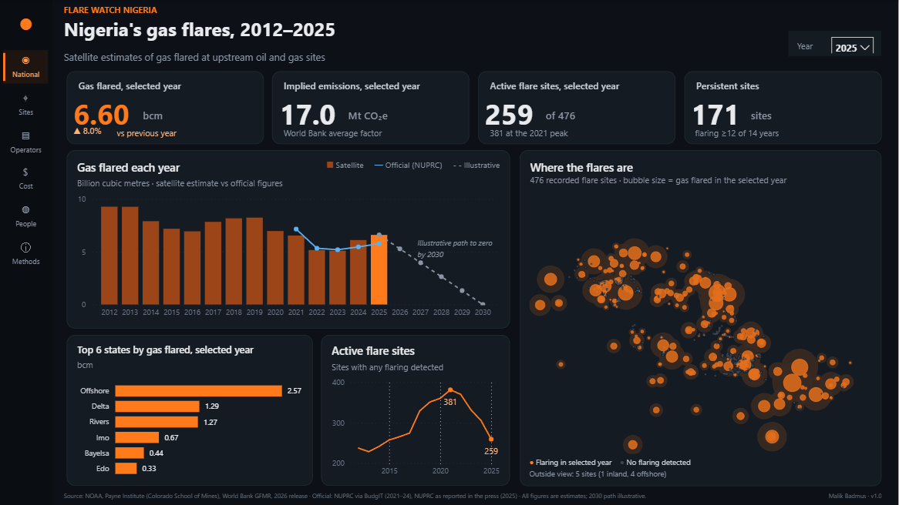

# Flare Watch Nigeria

**Satellite estimates of gas flaring in Nigeria, 2012–2025**: a descriptive, reproducible monitor, by flare site, oil or gas field, operator (as recorded) and nearby population. Author: Malik Kolawole Badmus.

The project combines:
- the World Bank Global Gas Flaring Reduction Partnership (GFMR) satellite-based flare volume estimates (NOAA / Payne Institute, Colorado School of Mines);
- Global Energy Monitor's Global Oil and Gas Extraction Tracker;
- WorldPop population data and geoBoundaries administrative boundaries.

It includes a six-page Power BI dashboard. Every number on the dashboard is checked against an independent Python calculation.

The project is descriptive: it reports estimated volumes and does not make claims about compliance, penalties, health effects or the conduct of any company.



## Key documents

| Document | What it is |
|---|---|
| [docs/findings.md](docs/findings.md) | **Findings for RQ1–RQ6** in plain English, plus what the study cannot claim |
| [docs/analysis_plan.md](docs/analysis_plan.md) | Analysis plan (frozen v1.0; SHA-256 in [docs/plan_freeze.md](docs/plan_freeze.md)) |
| [docs/amendments.md](docs/amendments.md) | Amendments A1–A3 to the frozen plan |
| [docs/phase0_results.md](docs/phase0_results.md), [docs/phase2a_results.md](docs/phase2a_results.md), [docs/phase2b_validation.md](docs/phase2b_validation.md) | Data checks, preparation and validation (independent recompute, official vs satellite, GEM cross-check, known data issues) |
| [docs/phase3_model.md](docs/phase3_model.md) | Power BI model: relationships, every measure with its DAX and check values |
| [docs/phase4_audit.md](docs/phase4_audit.md) | Final audit: every number on the dashboard against Python, and a wording audit against the safe-claim rules |
| [docs/sources_context.md](docs/sources_context.md) | Context citations (NOSDRA tracker, NUPRC 2030 target, World Bank top-nine countries) |

## Dashboard (`powerbi/report/FlareWatch.pbip`)

All six pages share a left navigation rail and a Year selector, synced across pages and set to 2025 by default.

| Page | Contents | Screenshot |
|---|---|---|
| 1. National | Estimated flaring by year with official figures and an illustrative path to 2030; active and persistent sites; top states; site map | [page1_national.png](figures/dashboard/page1_national.png) |
| 2. Sites | All 476 sites: map, table, trend for the selected sites, top 10 persistent sites by recent volume | [page2_sites.png](figures/dashboard/page2_sites.png) |
| 3. Operators | Operators and fields as recorded (World Bank 2026 release): concentration, top 12 operators, top 10 fields, top 5 operator trends | [page3_operators.png](figures/dashboard/page3_operators.png) |
| 4. Cost | Implied emissions, gross value of gas flared at market prices, implied flare fee at regulatory rates, assumptions | [page4_cost.png](figures/dashboard/page4_cost.png) |
| 5. People | Residents within 2 km / 5 km of flare sites (each person counted once), by state, top 10 persistent sites | [page5_people.png](figures/dashboard/page5_people.png) |
| 6. Methods | Satellite vs official 2021–2025, sources, definitions, known data issues, amendments, safe-claim rules, validation results | [page6_methods.png](figures/dashboard/page6_methods.png) |

### Opening the dashboard after cloning

The Power BI project reads the seven tables in `data/processed/` through a Power Query parameter, **`DataFolder`**. Its default value is `C:\flare-watch-nigeria\data\processed\`.

1. Open `powerbi/report/FlareWatch.pbip` in Power BI Desktop.
2. Go to **Home > Transform data > Edit parameters**. Set **DataFolder** to the full path of `data\processed\` in your clone, for example `D:\code\flare-watch-nigeria\data\processed\`. The path must end with a backslash.
3. Click **Apply changes**, then **Home > Refresh**.

If you clone to `C:\flare-watch-nigeria\`, you can skip step 2. The repository has no data cache (`.pbi/cache.abf`), so the visuals are empty until the first refresh.

## Data you must download yourself

The raw source files are **not** included (see `.gitignore`).
- **Which files you need:** only to re-run the pipeline from scratch. The Power BI tables in `data/processed/` and the checks in `data/interim/` are already committed.
- **Where they go:** put them in `data/raw/` with exactly these names. Their sizes and SHA-256 hashes are in `data/interim/phase0_sources.csv` and `data/interim/sources_phase2.csv`, and the tests check them.

| File (in `data/raw/`) | Source | Licence / terms (as recorded) |
|---|---|---|
| `Flare-Volume-Estimates-by-individual-Flare-Location-2012-2025.xlsx` | World Bank GFMR, https://www.worldbank.org/en/programs/gasflaringreduction/global-flaring-data | Attribution: NOAA, Payne Institute (Colorado School of Mines), World Bank GFMR. No explicit licence stated; World Bank disclaimer applies. |
| `Flare-volume-and-intensity-estimates-2012-2025.xlsx` | World Bank GFMR, same page | As above |
| `Global-Oil-and-Gas-Extraction-Tracker-March-2026.xlsx` | Global Energy Monitor, https://globalenergymonitor.org/projects/global-oil-gas-extraction-tracker | CC BY 4.0 |
| `docs/Global-Gas-FlaringTracker-June-23-2026.pdf` | World Bank, *Global Gas Flaring Tracker*, June 2026. Download it from the World Bank GFMR pages; the exact URL was not recorded. | Reproduction for noncommercial purposes with full attribution (report p.2) |
| `docs/World-Bank-s-Global-Gas-Flaring-Reduction-Partnership-Gas-Flaring-Estimates-Methodology-for-Determining-the-Gas-Flare-Volumes-from-Satellite-Data.pdf` | World Bank GGFR methodology note. Download it from the World Bank GFMR pages; the exact URL was not recorded. | No explicit licence stated; World Bank disclaimer applies |
| `worldpop/nga_pop_2025_CN_100m_R2025A_v1.tif` | WorldPop, https://doi.org/10.5258/SOTON/WP00839 | CC BY 4.0 |
| `boundaries/geoBoundaries-NGA-ADM1.geojson` | geoBoundaries gbOpen (from GRID3 2022), https://www.geoboundaries.org | CC BY 4.0 |
| `boundaries/geoBoundaries-NGA-ADM2.geojson` | geoBoundaries gbOpen (from GRID3 2022), https://www.geoboundaries.org | CC BY 4.0 |
| `docs/SoGF.pdf` | BudgIT, *The State of Gas Flaring in Nigeria*, https://budgit.org/wp-content/uploads/2026/01/SoGF.pdf | Cited only, not redistributed |
| `docs/FLARE-GAS-PREVENTION-OF-WASTE-AND-POLLUTION-REGULATIONS-2018.pdf` | Templars (law-firm copy), https://www.templars-law.com/wp-content/uploads/2018/09/FLARE-GAS-PREVENTION-OF-WASTE-AND-POLLUTION-REGULATIONS-2018.pdf | Law-firm copy, not the official gazette; cited only |

Other sources are cited only:
- Per Second News, 30 Jan 2026 (NUPRC 2025 figure; Amendment A1).
- NMDPRA domestic base price, reported by TheCable.
- The context sources in [docs/sources_context.md](docs/sources_context.md).

## How to reproduce

You need:
- Python 3.12, with the packages in [requirements.txt](requirements.txt).
- Power BI Desktop, for the dashboard.
- Node.js, only for the Power BI model scripts.

```bash
python -m venv .venv
.venv/Scripts/pip install -r requirements.txt            # Windows; use .venv/bin/ on macOS/Linux
.venv/Scripts/python -m pytest -q                         # works without data/raw (raw-file tests are skipped)

# with the raw files in data/raw/:
.venv/Scripts/python src/flare_watch/phase0_check.py      # source register and checks
.venv/Scripts/python src/flare_watch/phase2a.py           # cleaning, state/LGA assignment, population, Power BI tables
.venv/Scripts/python src/flare_watch/phase2b.py           # validation incl. the independent recompute (validation/recompute.py)
.venv/Scripts/python -m pytest -q                         # all 33 tests
```

### Power BI scripts (`powerbi/`)

These scripts need Power BI Desktop to be open with `FlareWatch.pbip`. They drive the Microsoft Power BI Modeling MCP server through `powerbi/mcp_client.py`, which runs `npx -y @microsoft/powerbi-modeling-mcp@1.0.1 --start`. The first run asks you to accept Microsoft's EULA.

| Script | What it does |
|---|---|
| `phase3_validate.py` | Checks the DAX measures against Python |
| `phase4_audit.py` | Audits every displayed number and all wording |
| `phase3_doc.py` | Regenerates `docs/phase3_model.md` |

The report pages are generated as PBIR JSON:
1. Close Power BI.
2. Run `page_night_build.py`.
3. Validate with `pbir_validate.py`. It checks the files against the Microsoft schemas in `powerbi/schemas/`, and its `--model` option checks every field against the model.
4. Copy `powerbi/pbir_staging/definition/pages` into `powerbi/report/FlareWatch.Report/definition/`.

## Validation status (v1.0.0, 2026-11-20)

- Independent recompute (DuckDB, shapely, pyproj): **68/68** pass.
- Power BI measures vs Python: **340/340** pass.
- Dashboard number audit: **138/138** pass. Wording audit: **0** safe-claim hits.
- Automated tests: **33/33** pass with the raw files; 28 pass and 5 are skipped without them.

## Safe-claim statement

- **Volumes:** all flaring volumes are **satellite estimates**, not measurements.
- **Operators:** shown **as recorded in the World Bank 2026 release** and applied to all years. Nothing here is a statement about any company's conduct.
- **Costs:**
  - Costs are **implied**: CO2e uses an implied average factor, and gas value is the gross value at market prices (not net revenue).
  - Flare fees are **implied at regulatory rates**. They are not amounts owed or paid, and they are not compared with fees collected.
- **Residents:** resident counts describe **proximity only** and make no exposure or health claim.
- **2030 path:** the straight-line path is **illustrative**. It is not a forecast, and no statement is made that Nigeria is on or off track.
- **Satellite vs official:** differences are **reported, not explained**.

## Licence

| Material | Licence |
|---|---|
| Code | MIT ([LICENSE](LICENSE)) |
| Documentation, figures and the author's derived data | CC BY 4.0 ([LICENSE-CC-BY-4.0.md](LICENSE-CC-BY-4.0.md)) |

Third-party data keep their own terms (see the table above).

## Citation

Badmus, M. (2026). *Flare Watch Nigeria: satellite estimates of gas flaring, 2012–2025* (v1.0.0). https://github.com/malikbadmus79-max/flare-watch-nigeria

See also [CITATION.cff](CITATION.cff).
